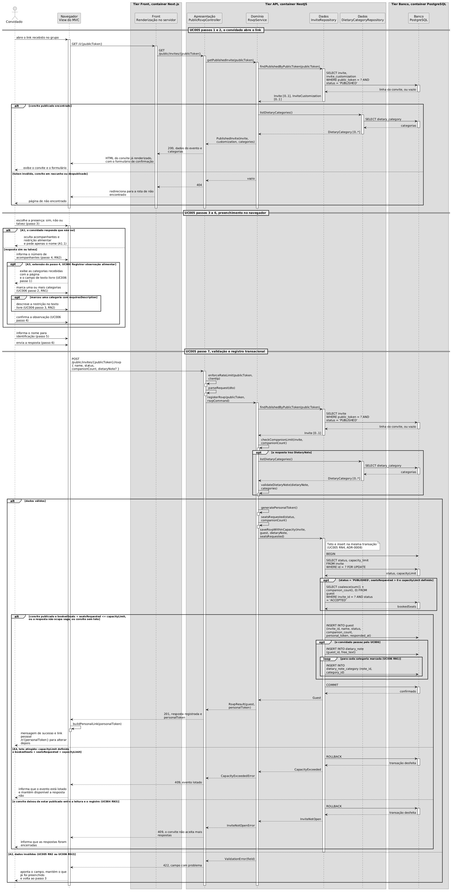
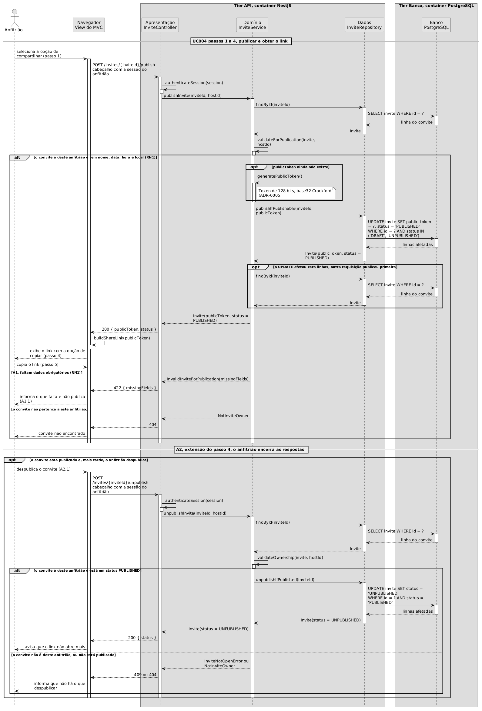
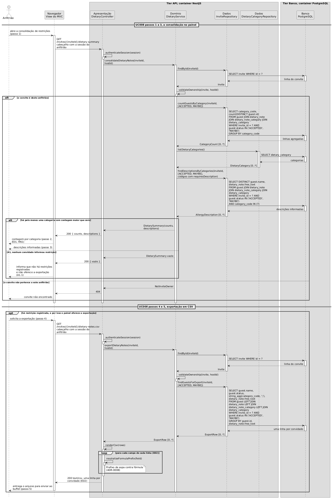
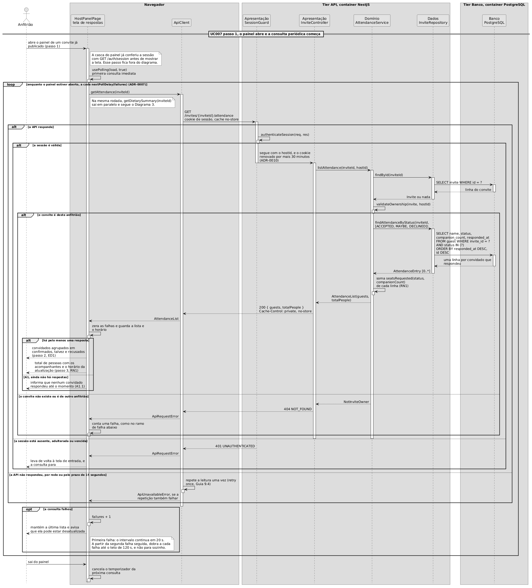

# Diagramas de Sequência

> **Três destes fluxos também existem em notação BCE**, os do UC004, do UC005 e do UC008, no [Documento de Realização de Casos de Uso](../Sprint-3/Documento-de-Realização-de-Casos-de-Uso.md) da Sprint 3, junto com o UC001. O UC007 só tem a versão desta página, porque o Documento de Realização o deixa de fora. Não são versões concorrentes: cada notação responde uma pergunta.
>
> **Esta página responde onde cada etapa acontece.** As linhas de vida são camadas e tiers, e por isso ela mostra a transação do teto de capacidade, o `SELECT ... FOR UPDATE` e os dois saltos de rede, que é o que sustenta o argumento da alocação por camada logo abaixo.
>
> **O Documento de Realização responde quais objetos colaboram.** As linhas de vida são Boundary, Control e Entity, e ali some o repositório e some a transação. O que dependia da transação virou valor de retorno de mensagem.
>
> Quem for implementar precisa das duas. Quem quiser conferir a regra de dependência do ADR-0001 usa esta.

Os diagramas mostram a ordem das interações nos principais fluxos do sistema e a camada responsável por cada etapa.

As linhas de vida representam os papéis de camada definidos no [ADR-0001](Decisões-Arquiteturais/0001-Estilo-arquitetural.md) e os tiers do [ADR-0002](Decisões-Arquiteturais/0002-Empacotamento-em-tiers.md), não as classes do [Diagrama de Classes](Diagrama-de-Classes.md). `Invite`, `Guest`, `DietaryNote` e `DietaryCategory` aparecem como dados trocados entre essas linhas.

Nos quatro diagramas, as chamadas seguem da Apresentação para o Domínio e do Domínio para os Dados. As linhas tracejadas mostram os retornos. O Domínio e os Dados não dependem da Apresentação.

## Diagrama 1, Confirmar presença

O diagrama cobre o UC005 e a extensão do UC006 no passo 4. Esse fluxo atravessa a fronteira pública e é o único que permite escrita sem autenticação.

### Decisões representadas

Na leitura, o navegador chama o tier Front. O Front renderiza a página no servidor e consulta a API pela rede do Compose. Esse é o caminho de dois saltos descrito no ADR-0002.

Na escrita, o POST vai do navegador direto para a API. O tier Front não repassa o comando, conforme a divisão definida no [ADR-0004](Decisões-Arquiteturais/0004-Stack-de-implementação.md).

O teto de capacidade é verificado dentro da transação. A sequência usa `BEGIN`, `SELECT ... FOR UPDATE`, contagem das vagas ocupadas, `INSERT` e `COMMIT`. No ramo de evento lotado, usa `ROLLBACK`.

Se essa verificação fosse feita na Apresentação, duas respostas simultâneas quando houvesse 49 de 50 vagas poderiam ser aceitas, levando o total a 51. Por isso, a regra fica na camada de Dados.

### Responsabilidades por camada

| Passo | Camada | Por quê |
|---|---|---|
| Limite de taxa | Apresentação | Controle de tráfego, não regra do caso de uso (ADR-0008) |
| Desserialização e tipos | Apresentação | Só forma. O conjunto de valores válidos é o `RsvpStatus` do Domínio |
| Limite de acompanhantes por resposta (RN2) | Domínio | Regra de negócio |
| Validação da observação alimentar (UC006 RN2) | Domínio | Depende de `requiresDescription` da categoria |
| Geração do `personalToken` | Domínio | A Apresentação nunca cria identificador |
| Teto de capacidade (RN4) | Dados | Invariante que depende do estado do banco e exige transação |

Também aparecem os fluxos A1 (recusa), A2 (dados inválidos), A3 (observação alimentar opcional) e A4 (evento lotado, com `ROLLBACK`). No A1, o fluxo segue para o passo 5 porque a recusa também precisa ser identificada por nome.

## Diagrama 2, Publicar convite e gerar link

O diagrama cobre o UC004 e a extensão A2, usada para despublicar o convite.

### Decisões representadas

O Domínio gera o `publicToken` com 128 bits de CSPRNG em base32 Crockford, totalizando 26 caracteres, conforme o [ADR-0005](Decisões-Arquiteturais/0005-Identificador-público-do-convite.md).

A geração fica dentro de um bloco `opt`, pois o token só é criado quando ainda não existe. Ao republicar um convite, o sistema reaproveita o link anterior. Despublicar apenas desativa o acesso, sem apagar o token.

A transição de situação é atômica sem uma transação explícita. O `UPDATE` verifica a situação no `WHERE` e faz a alteração no mesmo comando. Isso evita que dois cliques em compartilhar gerem tokens diferentes.

Esse fluxo explica a multiplicidade `[0..1]` do `publicToken` no Diagrama de Classes: o campo não existe antes da primeira publicação.

Quando o convite pertence a outro anfitrião, a API responde 404 em vez de 403 para não confirmar a existência do recurso, conforme o ADR-0008.

## Diagrama 3, Consolidar e exportar observações alimentares

O diagrama cobre o UC008, com a contagem por categoria e a exportação em CSV.

### Decisões representadas

A camada de Dados faz a agregação com `GROUP BY`. As linhas não são carregadas no Domínio apenas para serem contadas em memória.

A consolidação e a lista são consultas sobre `Invite` e `Guest`, não entidades. Nenhuma etapa grava uma tabela de consolidação.

A Apresentação trata a injeção de fórmula na exportação. Campos iniciados por `=`, `+`, `-` ou `@` recebem uma aspa simples como prefixo (ADR-0008). O banco mantém o valor original, e a alteração vale apenas para o CSV.

O texto vem de um formulário anônimo, passa pela API, é armazenado e depois chega a uma planilha usada pelo buffet. Como esse caminho não exige autenticação do convidado, o tratamento na saída é necessário.

## Diagrama 4, Visualizar lista de presença

O diagrama cobre o UC007, com o fluxo básico, o A1 (ainda não há respostas) e o que acontece quando uma consulta falha. Ele faltou na entrega do Grau A e foi desenhado em 13/11/2026 a partir do código, e não da especificação. Por isso os nomes de método e as assinaturas são os da implementação.

### Decisões representadas

A lista se atualiza por consulta periódica, conforme o [ADR-0007](Decisões-Arquiteturais/0007-Atualização-da-lista-de-presença.md). A tela de respostas do `HostPanelPage` consulta a API assim que abre e depois a cada 20 segundos, enquanto o painel estiver aberto. A consulta é a função `usePolling` de `front/src/controller/polling.ts`, e o intervalo é a constante `POLL_INTERVAL_MS`. Ao sair do painel, o temporizador da próxima consulta é cancelado.

As chamadas saem do navegador direto para a API, com o cookie de sessão. O tier Front entrega o bundle do painel e não participa de nenhuma chamada de dado, ao contrário da leitura do convite público no Diagrama 1. Por isso o tier Front não aparece como linha de vida.

Em cada rodada, a tela pede a lista de presença e a consolidação alimentar em paralelo. A segunda chamada segue o Diagrama 3 e aparece aqui só como nota.

Falha de consulta nunca vira lista vazia, conforme a seção 9.4 do Guia da Arquitetura. A tela mantém a última lista recebida, mostra o horário dela e avisa que pode estar desatualizada. Na primeira falha, o intervalo continua em 20 segundos. A partir da segunda falha seguida, ele dobra a cada falha até o teto de 120 segundos, e a consulta não para sozinha. Quando a API não responde, o `ApiClient` repete a leitura uma vez antes de devolver a falha, porque a leitura não altera dados.

O `SessionGuard` aparece como linha de vida própria porque, no código, ele roda antes do método do `InviteController`. Ele confere a assinatura do cookie sem consultar o banco e renova a janela de 30 minutos da sessão, conforme o [ADR-0010](Decisões-Arquiteturais/0010-Autenticação-do-anfitrião.md). Sem sessão válida, a API responde 401 e a tela leva o anfitrião de volta à entrada, o que encerra a consulta.

O total de pessoas da RN1 é calculado no Domínio, somando `seatsRequested` sobre as mesmas linhas que a tela exibe. É a mesma regra de vagas do teto de capacidade do Diagrama 1, e por isso não é repetida numa consulta de agregação no banco.

A resposta sai com `Cache-Control: private, no-store`. Uma resposta guardada em cache seria uma lista antiga mostrada como atual.

### Responsabilidades por camada

| Passo | Camada | Por quê |
|---|---|---|
| Intervalo da consulta e recuo em falhas | Controller do MVC, no navegador | Comportamento da tela, não regra do caso de uso (ADR-0007) |
| Autenticação da sessão | Apresentação | O Domínio nunca vê cookie (ADR-0010) |
| Conferência do dono do convite | Domínio | Autorização é regra do caso de uso. Convite de outro anfitrião e convite inexistente saem pelo mesmo 404 (ADR-0008) |
| Total de pessoas (RN1) | Domínio | Regra de negócio, a mesma de `seatsRequested` |
| Filtro por status e ordem por data da resposta (ED1) | Dados | Projeção de `Guest`, sem tabela própria |

## Pontos em aberto

Os diagramas encontraram quatro pontos que a especificação não resolvia:

1. **Exportação sem restrições.** A pré-condição do UC008 bloqueava a exportação quando ninguém informava uma restrição. Nesse caso, o anfitrião também ficava sem a lista de presença pedida na H12. Resolvido no A1 e no A2 do UC008: o CSV sai sempre que houver resposta sim ou talvez.
2. **Número de acompanhantes no CSV.** A ED2 do UC008 definia quatro colunas, sem a quantidade de acompanhantes, necessária para o planejamento do buffet. Resolvido na ED2 do UC008, que ganhou a coluna.
3. **Alteração da resposta.** A H09 aparece apenas como RN3 do UC005 e ainda não tem um fluxo próprio.
4. **Autenticação do anfitrião.** Nos diagramas do painel, que são os do UC004, do UC008 e do UC007, `authenticateSession` valida a assinatura de um cookie e devolve o `hostId` sem consultar o banco. A decisão está no [ADR-0010](Decisões-Arquiteturais/0010-Autenticação-do-anfitrião.md).

## Fontes dos diagramas

Gerados a partir dos arquivos `.puml` versionados em `/.attachments`, ao lado dos PNG. Para regerar:

    docker run --rm -e PLANTUML_LIMIT_SIZE=16384 -v "<caminho de docs/.attachments>:/data" plantuml/plantuml -tpng /data/diagrama-sequencia-uc005.puml

Para os outros diagramas, troque o nome do arquivo por `diagrama-sequencia-uc004.puml`, `diagrama-sequencia-uc008.puml` ou `diagrama-sequencia-uc007.puml`.

A variável `PLANTUML_LIMIT_SIZE` é necessária porque os diagramas passam do teto padrão de 4096 pixels. Sem ela o PNG sai cortado no rodapé.
