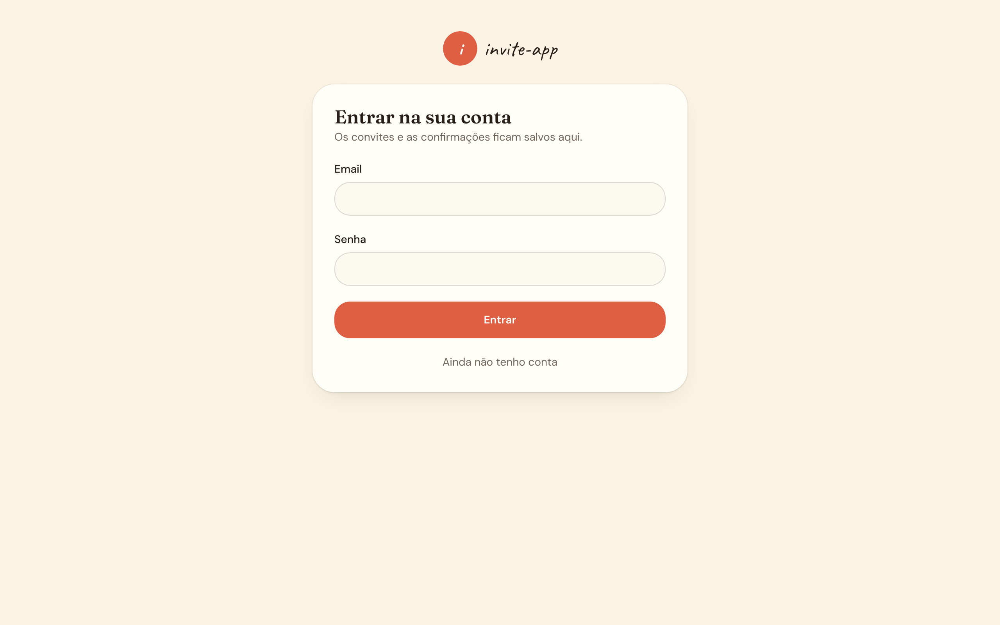
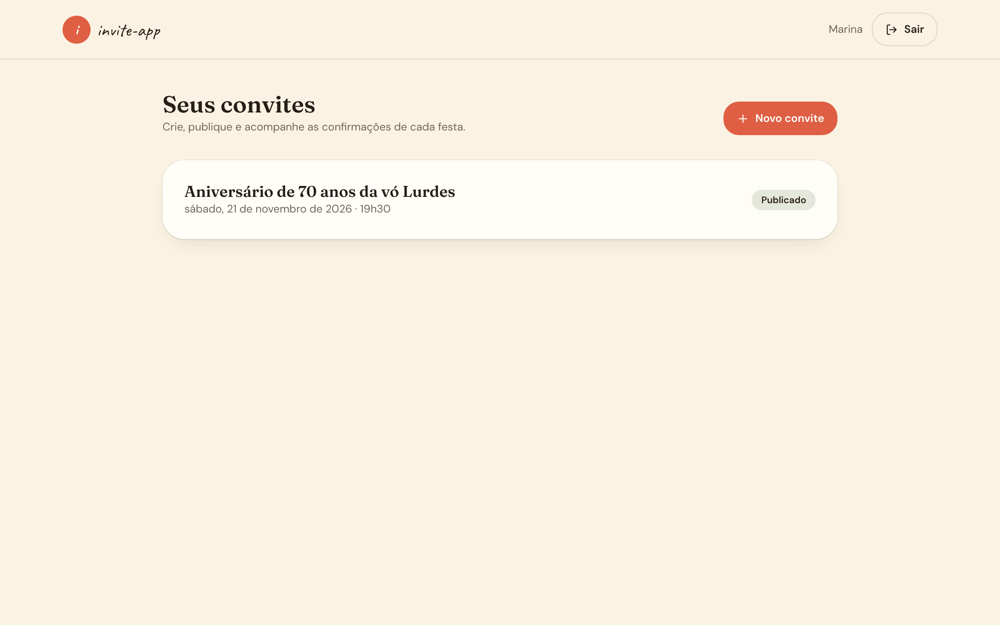
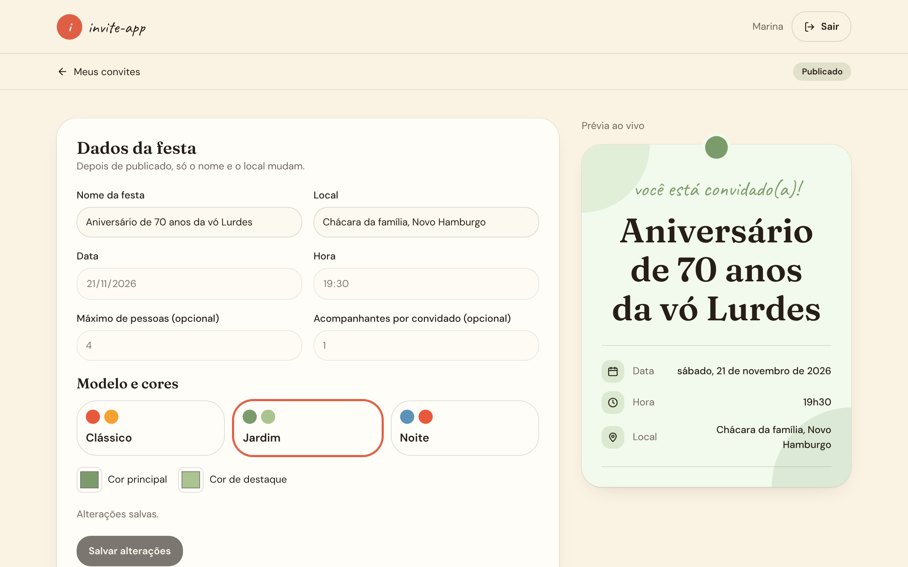
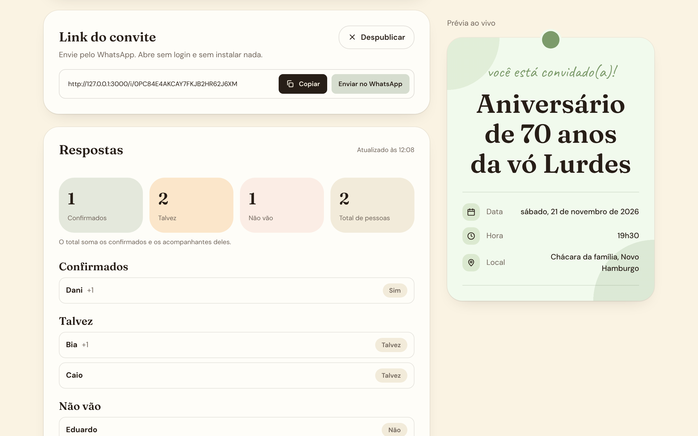
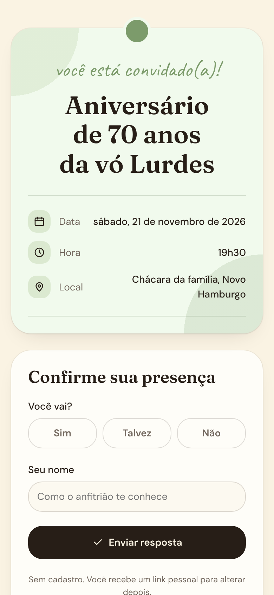
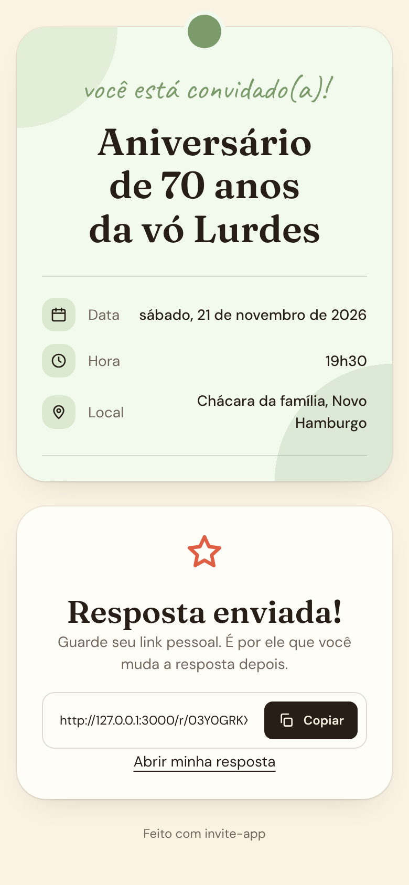
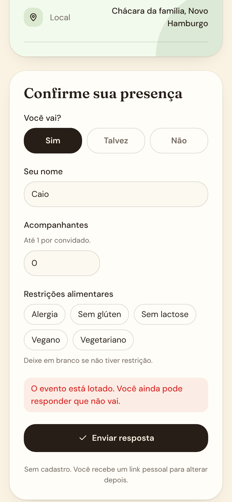
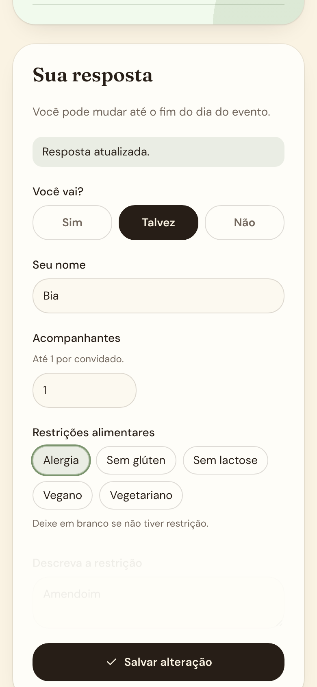
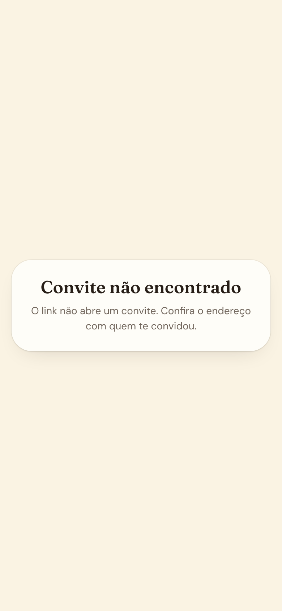

# Protótipo de Baixa Fidelidade

> **Atualização da Sprint 6.** O protótipo não foi entregue no Grau A. Esta página foi completada na Sprint 6 a partir das telas implementadas, e por isso mostra a aplicação como ela ficou, e não um esboço anterior ao código. As capturas são da aplicação rodando no ambiente local e estão em `/.attachments`, no mesmo padrão dos diagramas.

A página cobre as superfícies que o usuário alcança: a entrada e o cadastro do anfitrião, a criação e a personalização do convite, o convite público que o convidado abre pelo link, a tela que ele vê ao voltar para alterar a resposta, e o painel com lista de presença e consolidação alimentar.

As telas do anfitrião pertencem ao componente `HostPanelPage` e as do convidado ao `PublicInvitePage`, conforme o [Diagrama de Componentes](../Sprint-2/Diagrama-de-Componentes.md). As rotas de tela são as da linha 36 da seção 11.1 do [Guia da Arquitetura](../../Diretrizes-do-Projeto/Guia-da-Arquitetura.md).

| # | Tela | Rota | Componente | Histórias |
|---|---|---|---|---|
| 1 | Entrada e cadastro | `/sign-in` | `HostPanelPage` | H01 |
| 2 | Lista de convites do anfitrião | `/invites` | `HostPanelPage` | H01, H02 |
| 3 | Criação, correção e personalização, com prévia | `/invites/{inviteId}` | `HostPanelPage` | H02, H03, H04 |
| 4 | Link do convite e respostas | `/invites/{inviteId}` | `HostPanelPage` | H05, H06, H11, H12 |
| 5 | Convite público | `/i/{publicToken}` | `PublicInvitePage` | H05, H07, H08, H10 |
| 6 | Resposta enviada | `/i/{publicToken}` | `PublicInvitePage` | H07 |
| 7 | Evento lotado | `/i/{publicToken}` | `PublicInvitePage` | H08 |
| 8 | Link pessoal | `/r/{personalToken}` | `PublicInvitePage` | H09, H10 |
| 9 | Convite não encontrado | `/invite-not-found` | `PublicInvitePage` | H06 |

As histórias estão em [Histórias de Usuário](../Sprint-1/Histórias-de-Usuário.md).

---

## 1. Entrada e cadastro do anfitrião

**H01, UC001.** A anfitriã entra com email e senha. O link "Ainda não tenho conta" troca a mesma tela para o cadastro, que pede também o nome. Email inexistente e senha errada recebem a mesma mensagem, sem apontar qual dos dois errou, pelo A2 do UC001. Sem sessão, as telas do painel levam de volta a esta.

## 2. Lista de convites

**H01 e H02.** Depois da entrada, a anfitriã vê os próprios convites, o mais novo primeiro, com data, hora e situação. O botão "Novo convite" abre a criação do UC002. O nome dela e o botão "Sair" ficam no topo de todas as telas do painel.

## 3. Criação e personalização do convite

**H02, H03 e H04, UC002 e UC003.** À esquerda ficam os dados da festa: nome, local, data, hora e os dois limites opcionais, de pessoas e de acompanhantes por convidado. Data, hora e limites só mudam enquanto o convite é rascunho, e por isso aparecem travados no convite já publicado da captura. Abaixo vêm o template, entre Clássico, Jardim e Noite, e as duas cores que a anfitriã ajusta, a principal e a de destaque.

À direita, a prévia ao vivo mostra o convite com o mesmo componente que o convidado vê, e muda a cada alteração do formulário. Ela atende a H04 sem uma tela separada de prévia: a anfitriã confere o convite e continua editando na mesma tela. A saudação "você está convidado(a)!" é texto fixo do convite, igual nos três templates e estilizada pelo CSS de cada um, e o convite não tem recado livre, como registram os [Ajustes de Arquitetura para o MVP](../Sprint-5/Ajustes-de-Arquitetura-para-o-MVP.md), seção 1.1.

## 4. Link do convite, lista de presença e restrições

**H05, H06, H11 e H12, UC004, UC007 e UC008.** Na mesma tela do convite, depois de publicar, aparece o link `/i/{publicToken}`, com os botões de copiar e de enviar pelo WhatsApp, e o botão "Despublicar", que encerra as respostas.

A seção Respostas mostra os totais de confirmados, talvez e não vão, e o total de pessoas, que soma os confirmados e os acompanhantes deles. Abaixo, cada grupo lista os nomes, com os acompanhantes de cada um. A lista se atualiza sozinha a cada 20 segundos enquanto a tela fica aberta, pela consulta periódica do [ADR-0007](../Sprint-2/Decisões-Arquiteturais/0007-Atualização-da-lista-de-presença.md), e o horário da última atualização aparece no canto.

Mais abaixo na mesma tela, fora do recorte da captura, fica o bloco "Restrições para o buffet" da H12: a contagem por categoria, as descrições de alergia e o botão "Exportar CSV", que baixa a lista para o buffet.

## 5. Convite público

**H05, H07, H08 e H10, UC005 e UC006.** O convidado abre o link no celular, sem conta e sem instalar nada. O convite mostra nome, data, hora e local no template escolhido. O formulário pede a resposta, sim, talvez ou não, e o nome. Com sim ou talvez, aparecem o campo de acompanhantes, com o limite do convite, e as cinco categorias de restrição alimentar. Ao marcar alergia, aparece o campo de descrição.

## 6. Resposta enviada

**H07, UC005.** Depois de enviar, o convidado vê a confirmação e o link pessoal `/r/{personalToken}`, com o botão de copiar e o atalho para abrir a própria resposta. É por esse link que ele altera a resposta depois.

## 7. Evento lotado

**H08, UC005.** Quando o convite tem teto de pessoas e a resposta passaria dele, o envio é recusado com a mensagem de evento lotado, e o convidado ainda pode responder que não vai. A verificação acontece na transação da camada de Dados, pela medida 1 do [ADR-0008](../Sprint-2/Decisões-Arquiteturais/0008-Confiança-na-fronteira-pública.md), e por isso vale mesmo com duas respostas ao mesmo tempo.

## 8. Link pessoal

**H09 e H10, UC005 ED2 e RN3.** Pelo link pessoal, o convidado reabre a própria resposta, com o mesmo formulário já preenchido, e pode mudá-la até o fim do dia do evento. A tela mostra só a resposta dele, nunca a lista nem a contagem dos outros, pela regra da seção 5.3 do Guia. A mudança aparece no painel da anfitriã na consulta periódica seguinte.

## 9. Convite não encontrado

**H06, UC004 e ADR-0008.** Link inexistente, convite em rascunho e convite despublicado levam todos a esta mesma tela, sem dizer qual foi o caso, pela política de exposição da seção 9.5 do Guia. É o que garante o critério da H06 de que, enquanto rascunho, o link não abre para os convidados.

---

## O que as capturas não mostram

- A tela inicial em `/`, que apresenta o produto e leva à entrada.
- O formulário de criação de um convite novo, que tem os mesmos campos da tela 3.
- O bloco de restrições para o buffet, descrito na tela 4.
- A página de convite indisponível, que aparece quando a API não responde, pela seção 9.4 do Guia.
